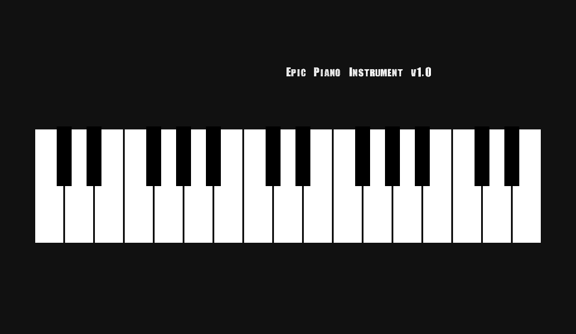

# Epic Piano Instrument 🎹

<p align="center">
    
</p>

> **The virtual piano instrument you have always been looking for.**  
> Blazing fast, lightweight, and engineered with pure C++ and RoninEngine, **Epic Piano Instrument** combines responsive keyboard playability, real-time waveform visualization, and instant recording capabilities into one cohesive musical experience.

---

## Why Epic Piano Is Exactly What You Need

Whether you are sketching out a melody, jamming on your computer keyboard, or looking for an ultra-responsive desktop virtual piano, **Epic Piano Instrument** delivers everything right out of the box:

- ⚡ **Zero-Lag Responsiveness**: Built directly in native C++ on top of [RoninEngine](https://github.com/badcast/ronin-engine) with low-latency audio playback. No heavy browser runtimes or bloated frameworks.
- 🌊 **Real-Time Waveform Visualizer**: Features a sleek neon oscilloscope wave pulsing dynamically across the background in real-time, responding directly to live PCM audio output.
- 🎛️ **Intelligent Pitch-Shifted Sound Engine**: Powered by a unified high-fidelity acoustic sample mathematically resampled across all 29 keys (semitone-accurate micro-pitching) — ensuring a featherlight RAM footprint without sacrificing tone.
- 🔴 **Instant Recording & Playback**: Capture your compositions on the fly, loop them effortlessly, and save/load tracks to pick up right where you left off.
- ✨ **Visual Immersion**: Interactive key press animations, smooth hover states, layered particle feedback, and ambient starlight backgrounds.
- ⌨️ **Full PC Keyboard Support**: Ergonomic two-row white & black key mappings enable full chromatic melodies directly from your QWERTY keyboard, plus complete mouse support.

---

## Key Features

- **29 Chromatic Keys**: Extended multi-octave range spanning white and black keys.
- **Dynamic Background Waveform**: Real-time multi-voice PCM mixing with smooth edge tapering and ambient idle animation.
- **Track Controls**:
  - **Record / Stop**: Track your performance note-by-note with sub-millisecond precision.
  - **Play / Pause**: Loop and preview your saved performance.
  - **Mute**: Instant silent mode for visual-only monitoring.
  - **EFX Remainder**: Tailored note decay simulation for realistic acoustic sustain.
- **Import / Export**: Save your recorded songs to disk and reload them at any time.

---

## Keyboard Controls

| Note Type | Key Bindings |
| :--- | :--- |
| **White Keys** | `Z`, `X`, `C`, `V`, `B`, `N`, `M`, `Q`, `W`, `E`, `R`, `T`, `Y`, `U`, `I`, `O`, `P` |
| **Black Keys** | `S`, `D`, `G`, `H`, `J`, `2`, `3`, `5`, `6`, `7`, `9`, `0` |
| **Mouse** | Left-click any key to play; drag across keys for glissando |
| **Reload Scene** | Right-click anywhere |
| **Exit** | `Escape` |

---

## Requirements & Building

### Prerequisites

- **CMake** (>= 3.10)
- **C++17** compatible compiler (`gcc`, `clang`, or MSVC)
- **SDL2**, **SDL2_image**, **SDL2_ttf**
- **PkgConfig** (Linux)
- [RoninEngine](https://github.com/badcast/ronin-engine) (included as submodule / parallel directory)

### Build Instructions

```bash
# Clone the repository
git clone https://github.com/badcast/epic-piano-instrument.git
cd epic-piano-instrument

# Configure and build
cmake -B build -DCMAKE_BUILD_TYPE=Release
cmake --build build

# Launch the instrument
./build/bin/epic-piano-instrument
```

---

## Author

- **badcast** ([GitHub](https://github.com/badcast)) — *Creator & Lead Developer*

---

## License

This project is licensed under the terms of the [LICENSE](LICENSE) file.
